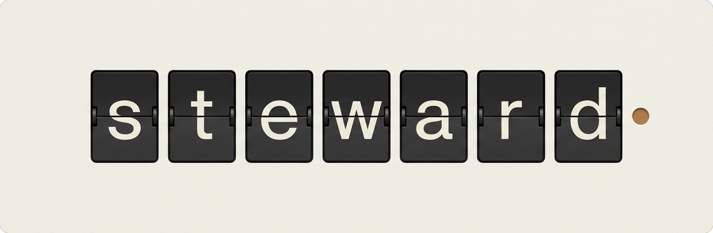

<p align="center">
  
</p>

<p align="center">
  <em>A three-tier Agent Skill: keep a frontier model in charge without paying frontier prices for the whole run.</em>
</p>

<p align="center">
  <a href="#getting-started">Getting Started</a> ·
  <a href="#how-it-works">How It Works</a> ·
  <a href="skills/steward/SKILL.md">Skill</a> ·
  <a href="evals/README.md">Evals</a>
</p>

- **Steward** (frontier model) — talks to you, turns your requests into tasks, and wakes up when a decision is needed or the work is done.
- **Orchestrator** (mid-tier subagent) — breaks tasks down, assigns them to workers, and checks their results.
- **Workers** (small, cheap subagents) — each handles one subtask at a time.

You only ever talk to the steward. The tiers coordinate through plain files in a `.steward/` folder inside your project, managed by a small Python script (`space.py`).

## Getting Started

Give your coding agent this repository (or [`skills/steward/SKILL.md`](skills/steward/SKILL.md)) and ask it to install Steward — it has everything it needs to wire up the skill, subagents, and nesting depth for your setup. Just let it know which mid-tier and cheap models you'd like to use for the orchestrator and workers.

Requires Python 3.10+ (on Windows, run under WSL).

## How It Works

Start a session on your main model, describe what you want done, and ask it to use the `steward` skill.

The steward creates `.steward/`, starts the orchestrator in the background, and hands control back to you. Whenever you send a follow-up — a change of plans, a new task, or a status question — the steward routes it without interrupting the orchestrator directly. When the orchestrator needs a decision or finishes the goal, the steward wakes up and reports back.

`.steward/` includes its own `.gitignore`, so temporary run state stays out of your repository.

## More Info

- **Skill prompts:** [`skills/steward/SKILL.md`](skills/steward/SKILL.md) and [`skills/steward/orchestrator-prompt.md`](skills/steward/orchestrator-prompt.md)
- **Evals:** [`evals/README.md`](evals/README.md)

Run the tests locally:

```sh
python3 -m unittest discover -s skills/steward/tests
```

## License

MIT — see [`LICENSE`](LICENSE).
